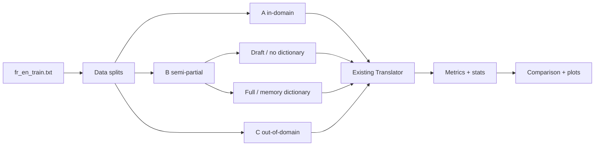

# Báo cáo tổng hợp FE_AGAL

## 1. Executive Summary
1. FE_AGAL được xây dựng trong thư mục riêng và không sửa code gốc.
2. Pipeline import trực tiếp `nhom3.engine.Translator`.
3. Model Pháp–Anh hiện hữu được phát hiện tại `models/nhom3_mt/model`.
4. Corpus Pháp–Anh chính có 300,000 cặp, không phải 50,000 cặp.
5. File Việt–Anh `vi_en_train.txt` có đúng 50,000 cặp.
6. Không tìm thấy từ điển FR–EN riêng; memory pairs được dùng làm fallback.
7. A, B1, B2 và C dùng seed cố định 42 và log reproducibility.
8. Chạy đầy đủ có thể tốn compute do mô hình 1.2 GB và retrieval auxiliary models.
9. COMET là đường ưu tiên; BERTScore hoặc zero fallback được ghi log nếu dependency/model không có.
10. Báo cáo được cập nhật từ outputs thực tế sau mỗi lần chạy.

## 2. Cấu trúc code và dữ liệu
Xem `logs/00_recon.md` để tra file, format, size và giả định.

## 3. Kịch bản và pipeline

## 4. Bảng metric
Xem `results/comparison.md` và `results/comparison.csv` sau khi chạy.

## 5. Dictionary impact
Xem `results/dictionary_impact.json`.

## 6. Phân tích lỗi và ví dụ định tính
Xem từng `results/{scenario}/qualitative.md`.

## 7. 50k
Xem `report/why_50k.md`.

## 8. Khuyến nghị
- Ưu tiên thêm split/test FR–EN ngoài domain thật thay vì synthetic placeholder.
- Ưu tiên chuẩn hóa encoding dữ liệu và lưu dictionary riêng có provenance.
- So sánh draft/full trên cùng hardware và kích thước mẫu đủ.
- Tăng số mẫu C/OOD và kiểm soát overlap < 0.1.
- Chạy COMET/BERTScore với dependencies được pin khi có GPU.

## ⚠️ Limitations & Caveats

- B2 hiện được gọi là `B2_with_memory_retrieval (upper bound)` vì engine hiện tại kích hoạt retrieval trên memory sentence pairs thay vì một word-level dictionary.
- COMET và BERTScore không khả dụng offline trong môi trường hiện tại nên không đưa vào kết luận.
- Số mẫu thực thi là 48/50/50/20; kết quả mang tính exploratory, không thay thế benchmark đầy đủ.
- chrF được debug bằng trường hợp khác nhau và giống hệt; implementation đã sửa sang sequence character n-grams.

## 🎬 Demo

Demo Streamlit nằm tại [app.py](../demo/app.py). Chạy trên Windows bằng `.\\FE_AGAL\\demo\\run.ps1`,
hoặc chạy Linux/macOS bằng `FE_AGAL/demo/run.sh`. Demo tự phát hiện CUDA và dùng CPU fallback.

## Khuyến nghị cải thiện cập nhật

- Bổ sung từ điển Pháp–Anh word-level thực thụ để đo đúng đóng góp của từ điển.

## 9. Phụ lục
- [Recon log](../logs/00_recon.md)
- [Data split notes](../data_splits/generation_notes.md)
- [Results](../results/comparison.md)
