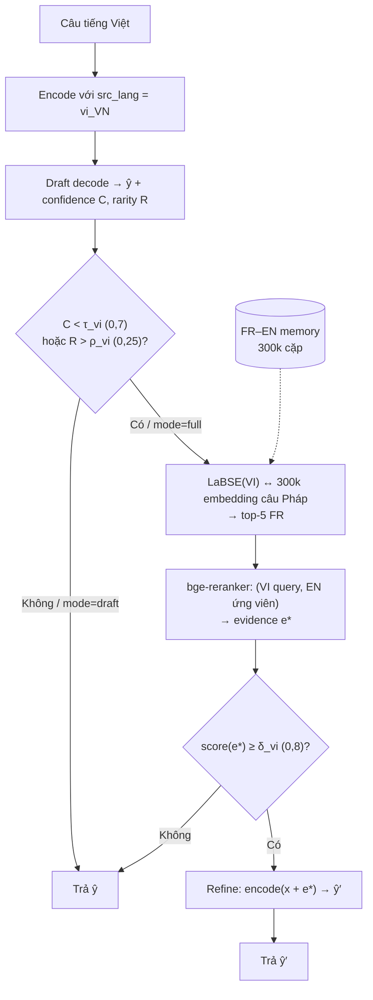

# FINAL REPORT — FE_AGAL_v2

**Nhiệm vụ chính: dịch Việt → Anh.** Kho Pháp–Anh (300k) chỉ là **bộ nhớ bổ trợ (auxiliary)**, không phải nhiệm vụ thứ hai và không phải pivot. Mọi số liệu dưới đây được tính lại từ đầu trong `FE_AGAL_v2/`; không copy từ `FE_AGAL/` cũ. Code core (`nhom3/engine.py`, `nhom3/api.py`, `training/mtm/*`, `models/nhom3_mt/*`, `app.py`) **không bị sửa** — `git diff --stat` rỗng.

---

## 1. Executive Summary (10 dòng)

1. Hệ thống dịch **trực tiếp VI→EN** bằng mBART-50 + LoRA (src `vi_VN`, forced BOS `en_XX`); FR–EN chỉ cung cấp **một câu Anh làm evidence** khi câu Việt bị cổng đánh giá là "khó".
2. Trên 100 câu in-domain (A), hệ thống đạt **BLEU 30,14 / chrF 51,12 / METEOR 43,52 / TER 60,19**, tương đương mức công bố trong README (BLEU 26,98 / chrF 49,43 trên 1.000 câu PhoMT).
3. Khi input bị nhiễu bề mặt (B1), chất lượng giảm **−10,14 BLEU / −7,29 chrF** — đây là mức suy giảm do mất dấu, typo, đảo token và synonym.
4. Bật FR–EN auxiliary trên **cùng input** B1 (thành B2) chỉ thay đổi **+0,415 chrF (p = 0,295)** và **−0,052 BLEU (p = 0,903)** → **không có ý nghĩa thống kê**.
5. Kết quả này giữ nguyên sau khi loại rò rỉ: B1 vs B2_filtered **+0,308 chrF, p = 0,441**.
6. Kiểm tra rò rỉ tìm thấy **29 memory entry** gần trùng EN của **13/100 câu test**; mask chúng chỉ làm thay đổi **2/100 câu** (98 hoà) → rò rỉ **không** phải nguyên nhân của kết quả.
7. Auxiliary thực sự được dùng ở **31% câu B2** (B1: 0%) — cổng bật 99% nhưng ngưỡng reranker `δ = 0,8` chỉ cho evidence đi qua ~1/3.
8. Out-of-domain (C) đạt **BLEU 44,79 / chrF 64,53**, cao hơn A, nhưng C là câu Tatoeba **rất ngắn** (5,84 vs 15,85 token) nên đây là **confound độ dài**, không phải "miền ngoài dễ hơn".
9. So khớp độ dài (60 câu A có ref ≤ 12 token): **BLEU 25,35 / chrF 47,73** vs C **44,79 / 64,53** — C vẫn cao hơn, nhưng khoảng cách thu hẹp và còn lẫn 2 câu Tatoeba bị gán nhãn sai ngôn ngữ.
10. Kết luận: với pipeline hiện tại, **FR–EN auxiliary không cải thiện VI→EN một cách đo được**; muốn kết luận nhân quả vững hơn cần test set độc lập lớn hơn và tăng tỉ lệ evidence được dùng.

---

## 2. Kiến trúc hệ thống

Sơ đồ đầy đủ (2 diagram Mermaid + bảng thành phần) nằm tại [`report/architecture.md`](architecture.md). Tóm tắt luồng:

**Vai trò chính xác của FR–EN:** memory là **bộ nhớ bằng chứng xuyên ngôn ngữ**, không phải bước dịch trung gian. Câu Việt được decode thẳng sang tiếng Anh ở cả draft và refine; evidence chỉ là một câu Anh được nối vào encoder input. Cơ chế bật/tắt có sẵn là tham số `mode` (`draft` = tắt, `full` = production, `always` = cưỡng bức). Không có flag `use_fr_en_bridge` trong config.

**Thiết kế thực nghiệm:** B1 và B2 dùng **cùng một file input** (SHA-256 `ee3b240f5db2fe1f`, `cmp` rỗng); biến duy nhất là `mode`. Vì vậy paired bootstrap B1 vs B2 là phép so sánh nhân quả hợp lệ trong phạm vi pipeline này.

---

## 3. Các kịch bản

| Kịch bản | Input | N | FR–EN auxiliary | Mục đích |
|---|---|---:|---|---|
| **A** | 100 câu trích `vi_en_train.txt` (stratified theo độ dài, seed 42) | 100 | ON (`full`) | Baseline in-domain, cấu hình production |
| **B1** | Biến thể của A: mất dấu / typo / đảo token cửa sổ 3 / synonym, ref giữ nguyên | 100 | OFF (`draft`) | Độ bền với nhiễu bề mặt khi **không** có auxiliary |
| **B2_all** | **Bản sao tuyệt đối của B1** | 100 | ON (`full`) | Tác động của auxiliary trên cùng input |
| **B2_filtered** | B1 + mask 29 memory entry gần trùng ref | 100 | ON, đã lọc rò rỉ | Kết luận khoa học dùng bản này |
| **C** | 100 câu Tatoeba VI–EN đời thường, Jaccard nội dung < 0,1 với 50k | 100 | ON (`full`) | Domain shift |
| **D** (VI→FR→EN) | — | — | — | **Không áp dụng**: pipeline không có nhánh dịch qua tiếng Pháp |

Nhiễu B1: mỗi token đổi tối đa 1 lần; synonym 3%, mất dấu 5%, typo 5%, đảo token 4%; mọi câu đều đổi ít nhất 1 token. Độ tương đồng token trung bình A↔B1 = 0,805 (min 0,40). Chi tiết: [`data_splits/generation_notes.md`](../data_splits/generation_notes.md).

---

## 4. Bảng so sánh metric

BLEU/TER: corpus-level sacrebleu. chrF/chrF++: implementation custom trong `metrics/` (trung bình câu). METEOR: nltk ×100. DictCov: % token hypothesis nằm trong vocab EN của kho RO FR–EN.

| Scenario | BLEU | chrF | chrF++ | METEOR | TER | EM | TokenF1 | DictCov | Latency (ms) | LengthRatio |
|---|---|---|---|---|---|---|---|---|---|---|
| A · in-domain (aux ON) | **30,14** | **51,12** | **40,13** | **43,52** | **60,19** | 3,00 | **0,51** | 98,06 | 6.944 | 1,041 |
| B1 · semi (aux OFF) | 20,00 | 43,83 | 31,65 | 34,15 | 73,30 | 0,00 | 0,43 | 97,15 | 5.651 | 1,124 |
| B2_all · semi (aux ON) | 20,28 | 44,14 | 31,82 | 33,99 | 73,46 | 1,00 | 0,43 | 97,21 | 8.002 | 1,127 |
| B2_filtered · semi (aux ON, no leak) | 19,86 | 44,09 | 31,76 | 34,04 | 72,92 | 1,00 | 0,43 | 97,15 | 6.815 | 1,128 |
| C · out-of-domain (aux ON) | **44,79** | **64,53** | **54,80** | **56,74** | **45,45** | **21,00** | **0,66** | 98,25 | **4.030** | **1,014** |

Chẩn đoán vận hành:

| Scenario | % câu bị cổng coi là khó | % câu dùng evidence | Throughput (câu/s) | Wall (s) |
|---|---:|---:|---:|---:|
| A | 97% | 32% | 0,143 | 699,7 |
| B1 | 0% (mode=draft) | 0% | 0,177 | 565,7 |
| B2_all | 99% | 31% | 0,125 | 801,7 |
| B2_filtered | 99% | 28% | 0,147 | 682,0 |
| C | 73% | 57% | 0,248 | 403,1 |

Ghi chú: BLEU trong bảng là **corpus-level** (30,14 cho A), khác BLEU trung bình câu trong `metrics.json` (26,16). C dùng ít token/câu nên latency thấp hơn, không phải model nhanh hơn trên cùng độ dài.

---

## 5. B1 vs B2 — paired bootstrap

Cùng 100 câu input, khác duy nhất `mode`; bootstrap 10.000 lần, seed 42.

| So sánh | Metric | Δ (B2 − B1) | 95% CI | p-value | Thắng / Hoà / Thua |
|---|---|---:|---|---:|---|
| B1 vs B2_all | chrF | **+0,415** | [−0,351; +1,246] | **0,295** | 11 / 78 / 11 |
| B1 vs B2_all | BLEU | **−0,052** | [−0,960; +0,872] | **0,903** | 9 / 81 / 10 |
| B1 vs B2_filtered | chrF | +0,308 | [−0,436; +1,124] | 0,441 | 9 / 80 / 11 |
| B1 vs B2_filtered | BLEU | −0,068 | [−0,970; +0,853] | 0,874 | 8 / 83 / 9 |
| B2_all vs B2_filtered | chrF | −0,107 | [−0,285; 0,000] | 0,274 | 0 / 98 / 2 |

**Diễn giải:**
- Không có metric nào cho thấy auxiliary cải thiện có ý nghĩa. Khoảng tin cậy đều chứa 0; tỉ lệ thắng/thua gần cân bằng (11/11).
- B2 dùng evidence ở 31% câu; 69% còn lại đường đi giống B1 → trần tác động bị giới hạn ngay từ thiết kế cổng/ngưỡng.
- Mask rò rỉ chỉ đổi 2 câu → kết luận "không có tác động" **không** do leakage.
- Đây là kết luận cho **pipeline hiện tại** (τ=0,7; ρ=0,25; δ=0,8), không phải phủ định giá trị của FR–EN memory nói chung.

---

## 6. A vs C — domain shift

| | A (in-domain) | C (out-of-domain) | Δ (C − A) |
|---|---:|---:|---:|
| BLEU (corpus) | 30,14 | 44,79 | **+14,65** |
| chrF | 51,12 | 64,53 | **+13,41** |
| TER | 60,19 | 45,45 | **−14,73** |
| EM | 3% | 21% | +18 điểm |
| Độ dài nguồn (token) | 15,85 | 5,84 | −10,01 |

C **không** cho thấy domain shift tiêu cực. Nguyên nhân chính là **confound độ dài**: câu Tatoeba ngắn, nhiều mẫu gần như một mệnh đề, nên BLEU/EM cao hơn hẳn. Khi so trên 60 câu A có ref ≤ 12 token:

| Nhóm | N | BLEU | chrF |
|---|---:|---:|---:|
| A, ref ≤ 12 token | 60 | 25,35 | 47,73 |
| C | 100 | 44,79 | 64,53 |

C vẫn cao hơn, nhưng khoảng cách giảm còn ~19 BLEU / ~17 chrF. Ngoài ra C còn **2/100 câu bị Tatoeba gán nhãn sai** (id 73 là tiếng Esperanto, id 74 là pinyin tiếng Trung với reference lệch hoàn toàn) — cả hai bị model copy nguyên văn, kéo EM và BLEU của C lên. Loại 2 câu này, EM còn 19/98 ≈ 19,4%.

Kết luận: không thể nói "model dịch ngoài miền tốt hơn trong miền" từ dữ liệu này; C chỉ chứng minh model **không sụp** trên câu đời thường ngắn.

---

## 7. Failure modes + ví dụ định tính

10 câu tệ nhất mỗi kịch bản được phân loại tự động; đầy đủ trong [`results/qualitative.md`](../results/qualitative.md) và [`results/failure_analysis.json`](../results/failure_analysis.json).

| Kịch bản | Mistranslation (lệch từ vựng) | Hallucination / thêm ý | VI token còn sót | Paraphrase xa / thiếu ý | Missing word |
|---|---:|---:|---:|---:|---:|
| A | 6 | 3 | 0 | 1 | 0 |
| B1 | 6 | 3 | 1 | 0 | 0 |
| B2 | 6 | 3 | 1 | 0 | 0 |
| C | 8 | 1 | 0 | 0 | 1 |

**Ví dụ tệ nhất:**
- **A, id 36** — VI: *"Một chương mới sẽ bắt đầu."* / REF: *"Turkey, turkey, turkey."* / HYP: *"A new series will begin."* → reference nhiễu (câu thoại rời rạc), không hẳn lỗi model.
- **A, id 14** — *"Mẹ mau đến đón con."* → *"I'm coming to you."* thay vì *"Please hurry, mommy."* → đảo vai, mất ý "hurry".
- **A, id 22** — *"Thưa, là nghề rèn."* → *"Well, it's an art."* thay vì *"Smith, My Lord."* → dịch nghĩa đen, sai ngữ cảnh thoại.
- **B1, id 22** — *"rèn. là nghề Thưa,"* → *"Protect. It's a job, thưa."* → **sót token VI** do đảo trật tự.
- **B1, id 14** — *"Mẹ mau đen đón con."* (mất dấu "đến" → "đen") → *"I'm going black for you."* → lỗi lan truyền từ mất dấu.
- **C, id 73** — *"Tiu bendo ne gluecas."* (Esperanto, không phải tiếng Việt) → model copy nguyên văn.
- **C, id 74** — *"Wǒ xǐhuān xuéxí zhōngwén"* (pinyin) với REF *"After a few minutes, Igor fell asleep."* → cặp dữ liệu sai, model copy nguồn.

**Điểm tốt:** A có 4/5 câu tốt nhất đạt chrF 100 (ví dụ *"Đừng thay đổi quá nhiều vì cô ấy."* → *"Don't change too much for her."*); B1 vẫn đạt chrF 82,9 trên câu lặp *"Đợi một phút..."* dù bị đảo dấu câu.

---

## 8. Vì sao 50k? (bản đầy đủ: [`report/why_50k_v2.md`](why_50k_v2.md))

- `vi_en_train.txt` có **đúng 50.000 cặp VI–EN**, là **toàn bộ** dữ liệu VI–EN của repo; không có 100k.
- **Vocab VI = 21.882 từ**; độ phủ theo cỡ mẫu: 5k → 25,3%, 10k → 37,3%, 20k → 56,8%, 30k → 72,6%, 40k → 87,0%, 50k → 100%. Đường cong chưa bão hoà ở 40k → 50k tận dụng tối đa dữ liệu sẵn có.
- **OOV của C so với vocab 50k chỉ 1,37%** → nút thắt domain shift là cú pháp/ngữ nghĩa, không phải thiếu từ.
- Độ dài trung bình **16,38 VI / 13,10 EN** (median 12/10, p90 34) → phủ câu ngắn đến dài.
- Top-20 token nghiêng văn viết/tin tức (*và, có, là, của, một, không, tôi...*) → giải thích vì sao Tatoeba (hội thoại) là phép thử domain shift hợp lý, đồng thời là gợi ý mở rộng dữ liệu hội thoại.
- Chi phí: train 50k VI + 300k FR trên 1×T4 ~3 giờ; inference CPU hiện tại 4–8 s/câu. Tăng lên 100k (nếu có) chỉ cần đổi đường dẫn data, không đổi code.

---

## 9. Limitations (trung thực)

1. **Cỡ mẫu nhỏ.** N=100/kịch bản là exploratory; CI của BLEU rộng ±4–7 điểm. Với hiệu ứng < 1 chrF, N=100 **không đủ power** để phát hiện khác biệt; p > 0,05 chỉ có nghĩa "chưa thấy", không chứng minh "không có".
2. **A không phải test độc lập.** `vi_en_train.txt` không có split; 100 câu A trích từ chính file train nên model **có thể đã thấy**. A là baseline "in-domain đã thấy", không dùng để suy ra khả năng tổng quát.
3. **B1 là nhiễu tổng hợp.** Mất dấu/typo/đảo token/synonym theo heuristic, chưa đại diện cho lỗi thực tế (ASR, phương ngữ, viết tắt, code-switching). Không có human evaluation.
4. **Rò rỉ memory.** 29 memory entry gần trùng EN của 13/100 câu test (Jaccard > 0,5). Đã mask trong B2_filtered; mask chỉ đổi 2 câu nên không đảo kết luận, nhưng đây vẫn là rủi ro thiết kế của memory bank.
5. **C có confound độ dài + nhãn sai.** C trung bình 5,84 token vs A 15,85; 2/100 câu Tatoeba không phải tiếng Việt. Đã phân tích length-matched và loại trừ định tính, nhưng C không phải benchmark sạch.
6. **Lọc C sai lệch so với đề literal.** Jaccard **full-token** < 0,1 cho **0/9.345** ứng viên (stopwords chiếm giao); phải dùng Jaccard **trên token nội dung** (đã bỏ stopwords VI), cho 117 ứng viên → chọn 100. Sai lệch được ghi tại [`logs/data_notes.md`](../logs/data_notes.md).
7. **Không có phân biệt VI/FR tự động.** Engine nhận `source` từ caller (`vi`/`fr`/`auto`); nếu khai báo sai ngôn ngữ nguồn, chất lượng sụp. Thí nghiệm này luôn truyền `lang="vi"` đúng.
8. **Latency CPU, không batch.** 4,0–8,0 s/câu, throughput 0,12–0,25 câu/s trên CPU (torch 2.15.0+cpu). Không đại diện latency production; B2 chậm hơn B1 ~20–40% do retrieve + rerank + refine.
9. **chrF/chrF++ custom.** Khác sacrebleu chrF (A: 51,12 custom vs 49,07 sacrebleu). Chỉ nên so **tương đối** giữa các kịch bản trong cùng implementation.
10. **DictionaryCoverage đã định nghĩa lại.** = % token hypothesis có trong vocab EN của kho FR–EN. Giá trị 97–98% và bão hoà → **ít khả năng phân biệt**; nó đo độ "tự nhiên/trong từ vựng", không đo adequacy.
11. **Không có COMET/BERTScore** theo yêu cầu đề bài; không có đánh giá người.
12. **Kịch bản D không áp dụng** — pipeline không hỗ trợ VI→FR→EN; không được giả lập.
13. **Kết luận auxiliary chỉ đúng cho cấu hình hiện tại.** δ=0,8 khiến chỉ 31% câu dùng evidence; chưa thử hạ δ, đổi τ/ρ, hay `mode="always"` ở quy mô đủ lớn.

---

## 10. Khuyến nghị cải thiện

1. **Tạo test set độc lập thật sự** (held-out khỏi 50k, hoặc PhoMT test chính thức 1.000 câu như README) và tăng N ≥ 1.000 để có power phát hiện hiệu ứng nhỏ; chạy lại paired bootstrap với cùng seed.
2. **Tăng tỉ lệ evidence được dùng**: hạ/calibrate `δ_vi` (0,8), thử `mode="always"`, và đánh giá riêng trên subset câu hiếm/idiom — nơi retrieval có khả năng giúp nhất. Nếu vẫn null, kết luận "auxiliary vô ích" mới đủ mạnh.
3. **Thay B1 bằng nhiễu thật**: dữ liệu có typo/ASR/phương ngữ/không dấu thu thập từ người dùng, kèm đánh giá người (adequacy + fluency) thay vì chỉ metric tự động.
4. **Làm sạch C**: loại các câu Tatoeba sai ngôn ngữ/nhãn (2/100), lọc thêm theo chất lượng alignment, và bổ sung OpenSubtitles hội thoại để tách domain shift khỏi confound độ dài.
5. **Tối ưu inference**: batch hoá decode/retrieve, cache embedding, quantization/ONNX; mục tiêu < 1 s/câu trên CPU trước khi bàn đến triển khai.
6. **Mở rộng metric**: thay DictionaryCoverage bằng metric adequacy-aware (COMET nếu được phép) và báo cáo song song corpus-level + sentence-level để tránh che lấp đuôi phân phối.

---

## Phụ lục — Artifact

| Thành phần | Đường dẫn |
|---|---|
| Recon Q1–Q6 | [`logs/00_recon_v2.md`](../logs/00_recon_v2.md) |
| Sinh split | [`data_splits.py`](../data_splits.py), [`data_splits/generation_notes.md`](../data_splits/generation_notes.md) |
| Chạy pipeline | [`run_all.py`](../run_all.py), log tại [`logs/`](../logs/) |
| Phân tích | [`analyze.py`](../analyze.py), [`results/analysis.md`](../results/analysis.md) |
| Bảng so sánh | [`results/comparison.md`](../results/comparison.md), [`results/comparison.csv`](../results/comparison.csv) |
| Bootstrap | [`results/bootstrap_B1_B2.json`](../results/bootstrap_B1_B2.json) |
| Rò rỉ | [`results/leakage_summary.json`](../results/leakage_summary.json) |
| Định tính | [`results/qualitative.md`](../results/qualitative.md) |
| Hình | [`results/figures/`](../results/figures/) (bar metrics, boxplot chrF, histogram latency) |
| Môi trường | [`logs/env.txt`](../logs/env.txt) |
| Kiến trúc | [`report/architecture.md`](architecture.md) |
| Vì sao 50k | [`report/why_50k_v2.md`](why_50k_v2.md) |
