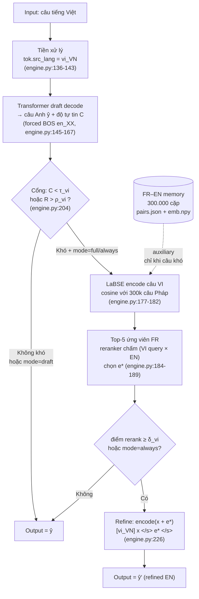
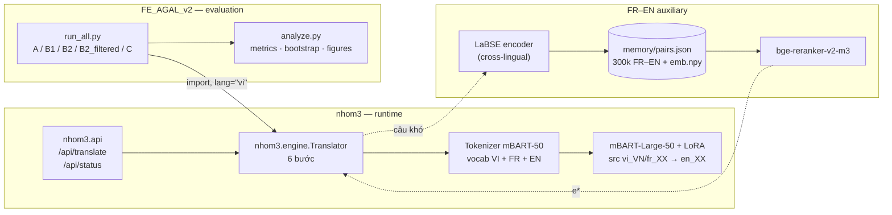

# Kiến trúc hệ thống VI→EN với FR–EN auxiliary

Tài liệu này mô tả **đúng** framing của đồ án: **nhiệm vụ chính là dịch Việt → Anh**; kho **Pháp–Anh chỉ là công cụ bổ trợ (auxiliary)** cho câu khó, không phải nhiệm vụ thứ hai và không phải pivot dịch.

## 1.1. Pipeline dịch VI→EN có FR–EN auxiliary

Điểm quan trọng:
- **Không có bước dịch VI→FR→EN.** Câu Việt được decode **trực tiếp** sang tiếng Anh ở cả draft và refine.
- Memory FR–EN chỉ đóng góp **một câu Anh làm bằng chứng (evidence)** được nối vào encoder input; decoder vẫn là cùng một mBART với đích `en_XX`.
- Có thể **tắt auxiliary** bằng `mode="draft"` (B1) và **bật** bằng `mode="full"` (A/B2/C) hoặc `mode="always"` (chẩn đoán).

## 1.2. Sơ đồ thành phần

| Thành phần | Vai trò | Vị trí |
|---|---|---|
| Model core | Dịch draft/refine VI→EN (và FR→EN) | `nhom3/engine.py` |
| Tokenizer | Chung vocab VI/FR/EN; phân biệt nguồn bằng `src_lang` | `models/nhom3_mt/model/tokenizer*` |
| FR–EN memory bank | 300k cặp Pháp–Anh + embedding LaBSE của câu Pháp | `models/nhom3_mt/memory/` |
| Retrieval + rerank | LaBSE tìm top-5, reranker chọn evidence | `engine.py:118-189` |
| API layer | Nhận `text, source, mode`, trả translation + chẩn đoán từng câu | `nhom3/api.py:51-82` |
| Evaluation layer | Sinh split, chạy 5 cấu hình, tính metric, bootstrap, báo cáo | `FE_AGAL_v2/` |

## 1.3. Vai trò của FR–EN auxiliary — giải thích chính xác

**FR–EN memory là gì?**
Là 300.000 cặp câu Pháp–Anh lấy từ `fr_en_train.txt` (TED2020 + News-Commentary), lưu trong `models/nhom3_mt/memory/pairs.json` (khóa `fr`, `en`) kèm `emb.npy` — embedding LaBSE của **câu Pháp** (`training/mtm/memory.py:30-57`, `engine.py:118-133`). Đây là dữ liệu **phụ**, không phải tập test VI–EN và không phải dữ liệu chính.

**Model dùng nó thế nào trong VI→EN?**
1. Câu Việt được dịch nháp trực tiếp sang Anh và tính độ tự tin `C`, độ hiếm `R`.
2. Nếu câu "khó" (`C < τ_vi` hoặc `R > ρ_vi`) và `mode != "draft"`: LaBSE mã hóa câu Việt rồi so cosine với embedding 300k câu Pháp (**retrieval xuyên ngôn ngữ Việt↔Pháp**). Lấy top-5.
3. Reranker chấm từng cặp (câu Việt, câu Anh tương ứng của ứng viên) và chọn câu Anh `e*` điểm cao nhất.
4. Nếu `score(e*) ≥ δ_vi`: nối `e*` vào encoder input và **dịch lại câu Việt**; nếu không: giữ bản draft.
5. Với ngưỡng production của VI (`thresholds.json`: τ=0.7, ρ=0.25, δ=0.8): khoảng **94%** câu VI bị coi là khó (có truy xuất), nhưng chỉ ~**28,5%** thực sự dùng evidence trên dev — nghĩa là auxiliary tác động có chọn lọc.

**Có cơ chế bật/tắt không?**
Không có flag tên `use_fr_en_bridge`. Cơ chế có sẵn là **tham số `mode`** của `Translator.translate(text, lang, mode)`:
- `mode="draft"` → **tắt hoàn toàn** auxiliary (không nạp/không tra memory);
- `mode="full"` → bật theo cổng (production);
- `mode="always"` → bật cưỡng bức cho mọi câu (dùng để chẩn đoán).

Vì vậy thực nghiệm can thiệp duy nhất giữa B1 và B2 là `mode`, giữ nguyên model, input, seed, reference:
- **B1** = `draft` (không auxiliary)
- **B2** = `full` (auxiliary theo production)
- **B2_filtered** = `full` + mask 29 memory index có câu Anh gần trùng reference test (Jaccard token > 0.5) trước bước top-k, để loại rò rỉ. Việc mask được làm ở phía evaluator (override `retrieve` bằng hàm bọc 6 dòng), **không sửa code core**.

**Kết luận vai trò:** FR–EN auxiliary là **bộ nhớ bằng chứng xuyên ngôn ngữ**, không phải dịch trung gian. Giá trị của nó với VI→EN là câu hỏi thực nghiệm, được trả lời bằng paired bootstrap B1 vs B2/B2_filtered (xem `results/analysis.md`).
